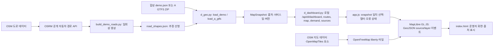

# D팀 오픈소스 활용과 자체 구현 근거

> 2026-11-16 재확인: 아래 라이브러리·서비스 명칭, 호출 파일, 라이선스와 자체 구현 경계는 실제 소스 및 각 프로젝트의 공식 고지와 대조했다. 운영자·시민 localhost HTML/API와 합성 경로는 응답했으나 Chrome 제어 도구가 현재 URL을 확인하지 못해 이번 변경의 지도 렌더링·UI 조작을 브라우저에서 수락하지 못했다.

> 2026-11-16 로컬 작업본 기준. 범위는 `web/operator`와 `src/busstrike/api/d_dashboard.py`, `d_geo.py`가 제공하는 **운영자 지도 개발 화면**이다. 저장소 전체 또는 다른 팀의 의존성 목록이 아니다. 화면은 실제 운행 정보가 아닌 시뮬레이션·자료 미연결 상태를 구분한다.

## 1. 활용 목적과 실제 도입 현황

서울 지도 위에 노선, 정류장, 수요의 출처가 다른 자료를 레이어로 표시하기 위해 [MapLibre GL JS](https://github.com/maplibre/maplibre-gl-js)를 사용한다. 지도 배경은 [OpenFreeMap](https://github.com/hyperknot/openfreemap)의 공개 `liberty` 스타일 및 타일 서비스를 이용한다. 배경에는 [OpenStreetMap](https://www.openstreetmap.org/copyright) 데이터와 [OpenMapTiles](https://github.com/openmaptiles/openmaptiles) 계열 스타일·타일 구성요소가 포함된다. 합성 버스 노선 6개의 **자동차 도로망 추정 선형**은 [OSRM](https://github.com/Project-OSRM/osrm-backend) 공개 데모 API를 1회 호출해 fixture로 저장했다. **MapLibre는 렌더링 코드**, OpenFreeMap은 **타일·스타일 서비스**, OSM은 **지도·도로 데이터**, OSRM은 **자동차 경로 엔진**이다. D가 OSM 도로 그래프를 직접 다운로드하거나 OSRM 서버를 설치·운영하지는 않는다.

| 구분 | 이름·공식 저장소 | 사용 버전/범위 | 확인한 라이선스 | 실제 적용 코드·역할 |
| --- | --- | --- | --- | --- |
| 직접 호출 | [MapLibre GL JS](https://github.com/maplibre/maplibre-gl-js) | CDN URL에 `6.18.0` 고정 | [BSD-3-Clause 및 포함 구성요소 고지](https://github.com/maplibre/maplibre-gl-js/blob/v6.18.0/LICENSE.txt); [해당 버전 package.json](https://github.com/maplibre/maplibre-gl-js/blob/v6.18.0/package.json) | `web/operator/index.html` CSS, `web/operator/app.js` `initMap`, `addSourcesAndLayers`, `updateMapData`, `updateSelection`, `fitAll`: 지도, GeoJSON, 상호작용 |
| 외부 스타일·타일 서비스 | [OpenFreeMap](https://github.com/hyperknot/openfreemap) 공개 `liberty` | CDN/타일은 공급자가 갱신하므로 앱에서 버전 고정 안 됨 | [저장소 코드는 MIT; 타일/스타일은 별도 권리](https://github.com/hyperknot/openfreemap/blob/main/LICENSE.md) | `web/operator/app.js` `initMap`의 `style: 'https://tiles.openfreemap.org/styles/liberty'`: 배경 지도 |
| 지도 기초 데이터 | [OpenStreetMap](https://www.openstreetmap.org/copyright) | OpenFreeMap이 제공하는 공개 타일에 포함; 데이터 시점은 D가 고정하지 않음 | [ODbL](https://www.openstreetmap.org/copyright) | OpenFreeMap 타일을 통해 **간접 사용**. `web/operator/index.html` 지도 안의 기여자·라이선스 링크 |
| 스타일·타일 구성요소 | [OpenMapTiles](https://github.com/openmaptiles/openmaptiles) | OpenFreeMap 제공분; D가 버전 고정 안 함 | [OpenFreeMap의 하위 권리 명세](https://github.com/hyperknot/openfreemap/blob/main/LICENSE.md): 코드 BSD-3-Clause, 디자인 CC BY 4.0 등 | 직접 패키지 호출은 없음. `web/operator/index.html` 출처 링크 |
| 외부 경로 API | [OSRM](https://github.com/Project-OSRM/osrm-backend) 공개 데모 서버 | 서버 버전·OSM 데이터 시점은 공급자가 관리하여 고정 불가; Python 클라이언트 패키지 미설치 | [OSRM 서버 BSD-2-Clause](https://github.com/Project-OSRM/osrm-backend/blob/master/LICENSE.TXT); 도로 자료는 OSM ODbL | `web/operator/build_demo_roads.py` `build`: `route/v1/driving` 요청으로 합성 6개 버스 노선 선형을 생성해 `tests/fixtures/d_dashboard/road_shapes.json`에 저장. 실행 시 API 호출 없음 |

MapLibre 및 OpenFreeMap의 소스 코드를 포크하거나 수정하지 않았다. `liberty` 스타일도 수정하지 않았다. D의 레이어 설정과 이벤트 핸들러는 **라이브러리를 이용한 자체 애플리케이션 코드**다. 브라우저에서 CDN과 타일을 불러와야 하므로 오프라인에서는 지도 배경이 표시되지 않는다. 외부 서비스 가용성과 이용 조건은 배포 전에 다시 확인해야 한다.

OSRM 엔진 코드를 포크하거나 수정하지 않았다. `build_demo_roads.py`는 표준 라이브러리 `urllib.request`로 [HTTP Route API](https://github.com/Project-OSRM/osrm-backend/blob/master/docs/http.md)의 `driving`, `overview=full`, `geometries=geojson`을 요청한다. 응답의 `waypoints[].distance`가 120m 이하인지와 선형·정차점 수를 확인하고, 원래 정차점 좌표와 도로 추정 좌표를 별도 저장한다. 6개 노선 사이 요청을 1.1초 이상 띄웠다. [공개 데모 정책](https://github.com/Project-OSRM/osrm-backend/wiki/Demo-server)은 비상업적 합리적 사용, 초당 최대 1회 요청, 가용성·데이터 갱신 보장 없음에 유의하도록 한다. 이 API를 배포 서비스의 상시 경로 엔진으로 사용하는 결정을 내리지 않았다.

## 2. 실제 API 호출과 D팀이 붙인 기능

| 오픈소스 API | 실제 호출 위치 | 제공 기능 | D팀 자체 처리 |
| --- | --- | --- | --- |
| `new maplibregl.Map({container, style, center, zoom})` | `web/operator/app.js` `initMap` | WebGL 배경 지도·팬·줌 | DEMO/A GTFS 모드, 자료 출처·오류 상태 표시 |
| `map.addSource('…', {type:'geojson', data})`, `map.addLayer(…)` | `addSourcesAndLayers` | GeoJSON 선·점·원 렌더링 | 파업/정상/셔틀 종류별 색·필터, 정류장/역, 합성 수요·겹침 레이어 구성 |
| `getSource(…).setData(…)`, `setFilter`, `setLayoutProperty` | `updateMapData`, `updateVisibleStops`, `updateDemand`, `updateSelection`, `updateVisibility` | 런타임 자료와 표시 상태 갱신 | API 응답의 `snapshot_id` 비교, 선택 노선 및 대표 정차점 강조, 레이어 선택 |
| `fitBounds`, `flyTo`, `zoomIn`, `zoomOut`, `getBounds` | `fitAll`, `focusSelected`, `updateMapData`, `updateVisibleStops`, `bindUI` | 카메라 이동·화면 범위 | 실제 GTFS의 선형 부재 시 서울 중심 이동, 현 화면 정류장만 지도 source에 넣기 |
| `map.on('click'/'mousemove'/'mouseleave')`, `new maplibregl.Popup(…)`, `new maplibregl.Marker(…)` | `addSourcesAndLayers`, `showStopHover` | 지도 객체 이벤트·팝업·DOM 마커 | 노선 선택, 정류장/수요 셀 출처·ID·인원 표시, 호버 이름 확대 |
| `map.addImage(…)`, `symbol` 레이어 | `addStopIcon`, `addSourcesAndLayers` | SVG 이미지를 지도 위치에 렌더링 | 자체 버스/전철 SVG와 정류장 종류 필터, 200ms 호버 확대 |
| OSRM `route/v1/driving/{waypoints}` | `web/operator/build_demo_roads.py` `build` | OSM 도로망의 자동차 경로 GeoJSON·스냅 거리 | 응답 검증·정차점별 출처 저장, 브라우저 API와 분리, 실제 버스 적합성 미검증 표시 |

직접 WebGL 렌더러, 지도 투영, 팬/줌, GeoJSON 화면 좌표 변환을 만들지 않아도 되며, D는 교통 데이터의 의미·출처·오류 처리와 화면 상태에 집중할 수 있다. **MapLibre가 파업 노선을 판정하거나 승객 수송을 계산하는 것은 아니다.** 노선 종류와 시간대별 합성 수요는 `d_geo.py`의 입력/변환과 D 화면 로직이 제공한다.

현재 `bus-stops`, `metro-stops`는 MapLibre **symbol 레이어**다. `app.js`의 `stopSvg`와 `index.html` 브랜드 헤더 SVG는 D가 직접 작성했으며 외부 아이콘 패키지에서 가져오지 않았다. `showStopHover`가 MapLibre `Marker`로 아이콘과 이름을 묶어 지도 위에 놓고 CSS가 200ms 확대/페이드를 적용한다. 클릭·터치 팝업은 MapLibre 이벤트로 연다. 따라서 Lucide/Tabler를 사용했다고 기재하지 않는다.

## 3. 자체 코드와 데이터 흐름

`d_geo.py`의 `load_a_gtfs`는 A 배포 ZIP에서 서비스일 활성 노선, 좌표, 대표 정차점, `routes.txt`의 분류 설명, 제공된 `shapes.txt`를 읽는다. 화면은 대표 운행편의 `stop_times.txt` 정차 순서를 정류장·역 이름에 연결한다. 철도는 전체 활성 운행편의 인접 역 쌍을 `schematic_stop_links`로 제공한다. `map_geojson`은 좌표를 `[경도, 위도]` 순서의 `LineString`/`Point`로 내보낸다. **A 배포본에 shape가 없으면 실제 선형은 만들지 않는다.** `app.js`의 `schematicFeatures`가 철도 인접 역과 선택 버스 대표 정차점을 별도 GeoJSON 점선으로 렌더링한다. 이는 정차 관계 개략도이며 도로·철로 형상 또는 거리 분석 입력이 아니다. `load_demo`는 7개 가상 노선·10개 가상 정류장과 80개 수요 셀을 만들고, 버스 6개 노선에 `road_shapes.json`의 OSRM 추정 좌표가 원본 정차점 순서와 일치할 때만 이를 덮어쓴다. `snapshot_id`에 두 fixture의 내용을 반영한다. 합성 전철 1개와 화면에서 새로 만든 셔틀은 도로/궤도 선형 미확인 점선으로 표시한다. `demand_geojson`이 시간대별 가상 수요를 반환한다. `d_scenario.py`는 합성 정상 노선 체크와 셔틀 배정을 받아 fixture의 정차 순서·시간당 가정 정원으로 미충족 원을 다시 계산한다. **OSRM 자동차 경로는 버스 통행 허가·정확한 실제 노선·배차 검증 결과가 아니다.** 특히 기존 정차점 사이 우회가 크므로 운행거리 지표에 사용하지 않는다.

`load_a_gtfs`는 같은 `stop_times.txt` 읽기에서 활성 운행편 전체의 정차점 ID도 노선별로 중복 제거해 저장한다. UI는 **대표 운행편의 정차 순서**와 **전체 운행편의 순서 없는 정차점 집합**을 별도 목록으로 보여 준다. 지도 위치 이동은 MapLibre `flyTo`와 `Popup`을 사용하며, 정류장 이름·ID 결합과 두 목록의 의미 구분은 D팀 자체 코드다.

`app.js`의 `demandHubs`는 API의 80개 합성 OD 셀을 지도 표시용 10개 거점 원으로 합산하고, MapLibre `circle-radius`와 `circle-opacity`의 증가 구간으로 인원이 큰 거점을 더 크고 진하게 그린다. `segmentKey`·`maskSharedSegments`·`routeFeatures`는 합성 DEMO에서 **정확히 같은 좌표의 선분**을 찾아 셔틀 GeoJSON에서 화면상 제외한다. 보이는 정상 노선이 바뀌면 `setData`로 복원·재계산한다. 이는 D팀 자체 표시 로직이며 Shapely의 `intersection`이나 실제 버스·철도 중복 분석을 사용한 결과가 아니다. 검증된 궤도 선형이 없는 합성 지하철, `shapes.txt`가 없는 A GTFS에서는 실제 공유 동선을 판정하지 않는다.

`d_dashboard.py`의 `Store.refresh`는 새 A 피드를 전부 읽은 뒤 스냅샷을 교체한다. 실패하면 이전 정상본을 유지한다. `Store.sources`는 A/B/C/M07의 실제 연결 상태를 반환한다. 현재 A GTFS 노선·정류장만 부분 연결이다. A 집계 OD와 파업 `Scenario`, B 셔틀 시간표/검증 결과, C `ServicePlan`, M07 독립 평가를 이 화면이 소비하지 않으므로 이들 지표는 `미연결` 또는 `미계산`으로 표시한다. `plan_id`/`revision`이 합성 fixture에 있는 것만으로 실데이터 운행안 연결이라고 주장하지 않는다.

## 4. 라이선스·출처 및 배포 시 확인 사항

1. **MapLibre 6.18.0**: BSD-3-Clause. 소스/바이너리 재배포 시 해당 버전의 저작권·면책 고지를 유지하고, 기여자 이름으로 제품을 보증하는 듯 표현하지 않는다. 프로젝트에 내장된 타사 구성요소 고지도 [버전별 LICENSE.txt](https://github.com/maplibre/maplibre-gl-js/blob/v6.18.0/LICENSE.txt)에 포함돼 있다. 현재 CDN 직접 로딩이며 로컬 재배포본은 없다.
2. **OpenFreeMap**: 공개 저장소 코드는 MIT지만 공급 타일, 스타일, 폰트, 아이콘의 모든 권리가 MIT인 것은 아니다. `liberty` 스타일은 [BSD-3-Clause 코드와 CC BY 4.0 디자인 등을 포함](https://github.com/hyperknot/openfreemap/blob/main/LICENSE.md)한다. 공개 타일 서비스에는 별도의 [이용약관](https://openfreemap.org/tos/)이 적용되며 가용성 보장이 없다. 현재 D는 타일을 내려받아 재배포하거나 스타일을 수정하지 않는다.
3. **OpenStreetMap**: 지도 데이터는 ODbL이며 기여자 표시와 라이선스 안내가 필요하다. [OSM 공식 저작권 안내](https://www.openstreetmap.org/copyright)에 따라 지도 안에 `© OpenStreetMap contributors` 링크를 둔다. OSM 데이터를 수정·추출해 재배포하는 경우 ODbL 의무를 별도 검토한다. D는 OSM 공식 타일 서버를 직접 호출하지 않는다.
4. **OpenMapTiles**: OpenFreeMap 스타일을 통한 간접 사용이며 별도의 출처 링크를 지도에 표시한다. 현재 D가 자체 OpenMapTiles 패키지를 설치·수정한 것은 아니다.
5. **OSRM 공개 데모/OSM 도로 자료**: OSRM 서버 코드는 BSD-2-Clause, 도로 입력은 OSM ODbL이며 서로 별개다. 현재 도로 추정 fixture를 저장소에서 공유하므로 지도 화면에 `OSRM 경로 추정`과 `© OpenStreetMap contributors` 링크를 둔다. OSM 파생 도로 자료의 재배포·변형·공개 데이터베이스 사용에 따른 ODbL 적용 범위는 공개 배포 전 검토한다. 공개 데모 서버는 지속 운영·일정한 도로망 버전을 보장하지 않는다.

출처 표시는 `web/operator/index.html`의 지도 하단 링크에 있다. 이를 가리는 UI 변경이나 스크린샷 크롭을 피한다. 공개 배포 주체는 실제 화면에서 출처가 읽히는지, 스타일의 attribution이 누락되지 않는지, 사용 당시 약관과 CDN 가용성을 재검토해야 한다.

## 5. 검증 근거와 미도입 기술

`tests/api/test_d_dashboard.py`의 합성 GeoJSON, OSRM 선형 상태·스냅 상한, GTFS shape 유무/좌표 순서, 서비스일, 중첩 ZIP, 실패한 refresh 보존 테스트는 **D 데이터 어댑터**를 검증한다. `tests/api/test_d_dashboard_http.py`는 로컬 JSON 응답과 합성 셔틀 추가·제거의 수요 변화, A 피드 미설정 상태를 HTTP로 검증한다. `tests/routing/`은 합성 시민 검색과 정상 도달 가능 조회를 검증한다. 이 테스트들은 MapLibre 브라우저 렌더링·타일 가용성·라이선스 준수를 자동 검증하지 않는다. 이번 변경 이후의 DEMO/A 마커·노선 강조·수요 원·신규 셔틀 UI는 브라우저에서 수락하지 못했다. 도로 선형의 실제 버스 통행 가능성, A 노선과 일치 여부, 중복 구간도 검증하지 않았다. 실행 명령과 최신 결과는 `d-operator-dashboard-handoff.md`에 기록한다.

| 기술 | 상태 | 이유 |
| --- | --- | --- |
| [Shapely](https://github.com/shapely/shapely) | **미설치·미사용, 도입 후보** | A/B 방향별 실제 도로 선형과 오차 기준이 없어 `LineString`, `buffer`, `intersection`으로 의미 있는 중복 길이를 계산할 수 없다. 과거 DEMO의 공통 구간 좌표는 분석 결과가 아니므로 현재 화면에 표시하지 않는다. |
| [OSMnx](https://github.com/gboeing/osmnx), [Valhalla](https://github.com/valhalla/valhalla) | **미설치·미사용, 도입 후보** | 지역·시점·버스 통행 가능 조건·A 네트워크와의 정합 검증 및 서버 운영 결정이 선행돼야 한다. OSRM 공개 데모를 합성 예제의 오프라인 선형 생성에만 사용했다. |
| [Lucide](https://github.com/lucide-icons/lucide), [Tabler Icons](https://github.com/tabler/tabler-icons) | **미설치·미사용, 도입 후보** | 현재 화면은 자체 작성 SVG 버스·전철 아이콘을 사용한다. 외부 SVG로 교체하면 실제 SVG 파일·출처·라이선스를 함께 기록한다. |
| FastAPI, Leaflet | **D 운영자 로컬 화면에서 미사용** | Python `http.server`와 MapLibre를 사용한다. 다른 모듈의 설치/사용과 구별한다. |

관련 기술 비교 및 미완료 공간 분석 조건은 [지도 스택 검토](d-opensource-map-stack.md)에 있다. 공식 M08 API, 공용 스키마 또는 배포 기술 스택을 이 문서로 확정하지 않는다.
