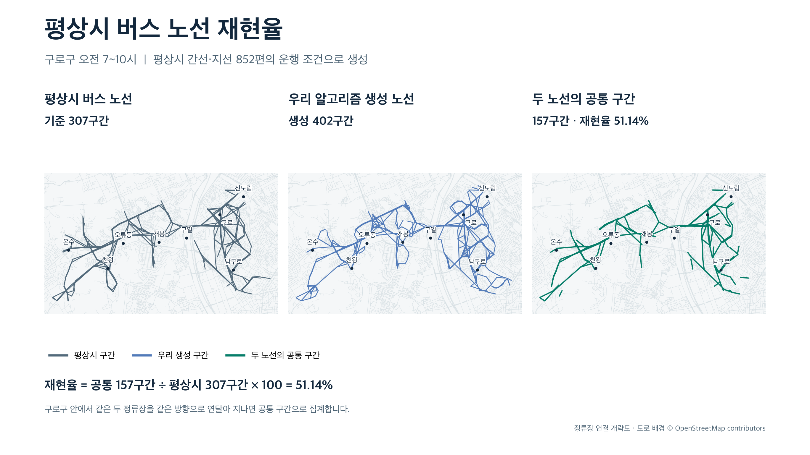
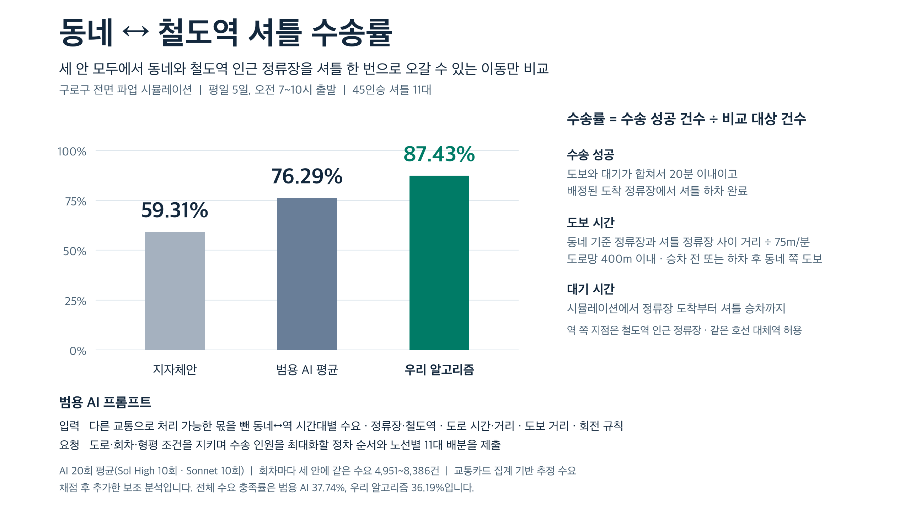
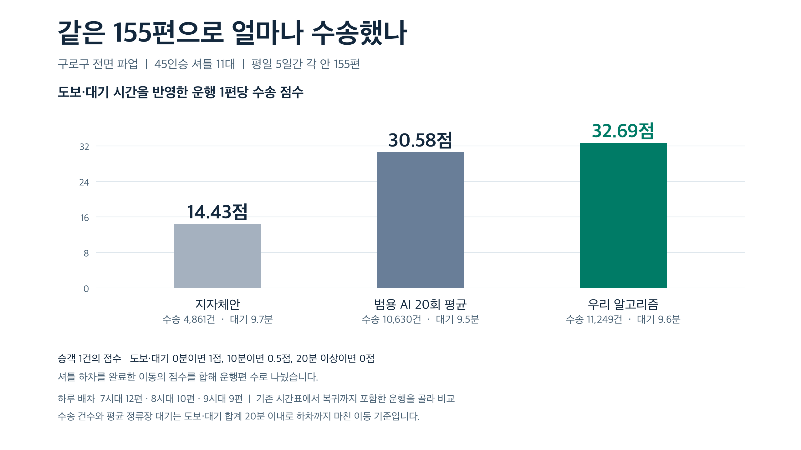

# 구로구 프로토타입 평가

구로구를 사례로 생성 노선의 평상시 구간 재현율, 파업 시 셔틀 수송률, 같은 배차에서의 수송 효율을 측정했습니다. 수치는 교통카드 집계 기반 수요와 시간표를 사용한 시뮬레이션 결과입니다.

| 지표 | 지자체안 | 범용 AI 20회 평균 | 우리 알고리즘 |
| --- | ---: | ---: | ---: |
| ① 평상시 노선 재현율 | — | — | **51.14%** |
| ② 세 안 공통 수요의 동네↔철도역 셔틀 수송률 | 59.31% | 76.29% | **87.43%** |
| ③ 동일 배차의 도보·대기 반영 수송 점수 | 14.43점/편 | 30.58점/편 | **32.69점/편** |

## ① 평상시 버스 노선 재현율

파업 노선을 지정하지 않고 구로구 오전 7~10시 평상시 간선·지선 852편의 운행 조건으로 노선을 생성했습니다. 입력 수요에서 마을·경기버스가 처리할 수 있는 몫을 뺐습니다. 구로구 안에서 같은 두 정류장을 같은 방향으로 연달아 지나면 공통 구간으로 셉니다. 우리 안은 평상시 307구간 중 157구간(51.14%)과 일치했습니다. 이 실험은 운행 조건에 맞춰 생성한 노선과 평상시 노선의 구조적 겹침을 측정합니다. [구간 집계](results/normal-route-summary.json)

## ② 동네↔철도역 셔틀 수송률

2026년 10월 26~30일 오전 7시 이상 10시 미만에 출발하는 동네↔철도역 이동 중 도보와 정상 운행 교통으로 처리 가능하다고 추정한 몫을 제외한 51,780건을 평가했습니다. 지자체안은 구로구 운영안의 팀 전사본 revision 3을 사용했습니다. 모든 안에 45인승 셔틀 11대와 오전 7~11시 운영창을 적용했습니다.

- **분모**는 회차별로 지자체안·해당 AI안·우리 안 모두에서 셔틀 한 대로 이동 가능한 수요입니다. 회차당 4,951~8,386건이며, 세 안에 같은 분모를 적용했습니다.
- **분자**는 그중 동네 쪽 도보시간과 정류장 대기시간을 더해 20분 이내이며, 셔틀에서 하차까지 마친 이동입니다. 동네 기준 정류장에서 셔틀 정류장까지 도로망 도보 400m 이내를 허용하고, 거리를 분당 75m로 나눴습니다. 대기시간은 시뮬레이션 승차 시각에서 정류장 도착 시각을 뺀 값입니다. 역 쪽은 지정 정류장과 같은 호선의 대체역을 허용합니다.
- **집계 범위**는 동네와 철도역 인근 정류장 사이 셔틀 구간입니다. 셔틀 간 환승, 지하철 탑승·환승·이동 및 최종 목적지까지의 여정은 집계 범위 밖입니다.

공통 수요 충족률은 채점 후 추가한 보조 분석이며, AI 20회 각각의 비율을 같은 비중으로 평균했습니다. 전체 셔틀 수요 기준 충족률은 지자체안 17.55%, 범용 AI 37.74%, 우리 안 36.19%였습니다. [공통 수요 회차별 집계](results/common-demand-rounds.csv) · [전체 수요 기준안](results/full-demand-baselines.csv) · [Sol High](results/full-demand-sol-high.csv) · [Sonnet](results/full-demand-sonnet.csv)

### 범용 AI에 제공한 입력과 요청

Sol High와 Sonnet에 동일한 시간대별 동네↔역 잔여 수요, 정류장과 철도역 연결 정보, 도로 이동시간·거리, 도보 거리와 정류장 회전 규칙을 제공했습니다. 45인승 셔틀 11대를 노선별로 배분하고, 도로·회차·형평 조건을 충족하는 정차 순서를 설계해 수송을 최대화하도록 요청했습니다. 모델별 10회를 평가했고 Sonnet 4·5회는 U턴 오류 수정 후 다시 채점했습니다. [실험 프롬프트](prompts/strike-shuttle.md)

## ③ 같은 배차에서의 수송 효율

②의 각 노선, 정차 순서와 차량 배정을 유지했습니다. 기존 시간표에서 영업 운행과 차량 복귀가 연결된 회차를 골라, 모든 안의 시간대별 출발편 수를 하루 07시대 12편, 08시대 10편, 09시대 9편으로 맞췄습니다. 안마다 5일 합계 155편이며 시간대 안의 개별 출발 시각은 안별 시간표를 따릅니다.

하차를 마친 이동 1건의 점수는 `max(0, 1 − (도보분 + 대기분) ÷ 20)`입니다. 하차하지 못하면 0점입니다. 승객별 점수 합계를 155편으로 나눠 편당 수송 점수를 구했습니다.

| 운행안 | 5일간 수송 완료 | 평균 정류장 대기 | 수송 점수/편 |
| --- | ---: | ---: | ---: |
| 지자체안 | 4,861건 | 9.68분 | 14.43 |
| 범용 AI 20회 평균 | 10,630.3건 | 9.52분 | 30.58 |
| 우리 알고리즘 | 11,249건 | 9.62분 | **32.69** |

수송 건수와 평균 대기는 도보·대기 합계 20분 이내에 하차를 마친 이동을 대상으로 합니다. 우리 안은 AI 평균보다 618.7건 더 수송했고, 편당 점수는 6.9% 높았습니다. M07에서 실행된 검사는 110건 모두 실패가 없었으며 V12·V15·V16은 미검증입니다. [요약](results/matched-dispatch-summary.csv) · [회차별 결과](results/matched-dispatch-rounds.csv) · [시간대별 출발편 수](results/matched-dispatch-hourly.json)

