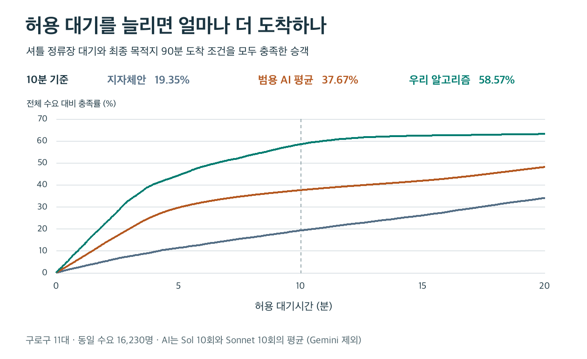

# 구로구 파업 셔틀: 같은 11대로 누가 제시간에 도착했나?

구로구 출근 승객 16,230명을 대상으로 한 M07 시뮬레이션이다. 운영자가 입력한 차량 수는 11대(대당 45석)다. 우리 알고리즘(E3)은 지자체안보다 **4,740명 더 많은 승객**을 90분 안에 목적지 역까지 보냈다. Sol과 비교하면 90분 도착률은 소폭 낮았지만, **10분 안에 탑승하고 90분 안에 도착한 비율은 2.98%p 높았다.**

## 왜 두 가지를 세나?

첫 번째 질문은 **“파업 때 목적지까지 갈 수 있었나?”**다. 두 번째는 **“제때 도착한 사람 중 누가 오래 기다리지 않아도 됐나?”**다. 두 지표 모두 분모는 전체 16,230명으로 고정한다. 그래야 태우기 쉬운 사람만 태운 운행안이 높은 점수를 얻는 일을 줄일 수 있다.

| 승객 예시 | ① 90분 내 도착 | ② 10분 내 탑승 **및** 90분 내 도착 |
|---|---|---|
| 정류장에서 8분 대기, 출발 후 70분에 도착 | 포함 | 포함 |
| 15분 대기, 출발 후 70분에 도착 | 포함 | 제외 |
| 5분 대기, 출발 후 95분에 도착 | 제외 | 제외 |
| 셔틀을 타지 못함 | 제외 | 제외 |

- **① 도착률(주지표)** = 90분 안에 최종 목적지 역에 도착한 인원 ÷ 16,230 × 100. 90분은 M07 평가 프로토콜의 출근 통행 기한이다.
- **② 대기·도착 동시 충족률(보조지표)** = 대기 10분 이하이면서 총 이동시간 90분 이하인 인원 ÷ 16,230 × 100. 10분은 기존 시나리오의 대기 보고 기준이다. 이를 도착 조건과 결합한 지표는 이번 탐색 분석에서 추가했다.
- **시간의 시작점:** 총 이동시간은 원래 승차 정류장에서 출발한 때부터 센다. 승차 전 도보, 셔틀 대기·이동, 하차 후 도보, 철도 이동·대기·환승을 포함한다. 승차 전 도보는 정류장 간 직선거리 × 1.3 ÷ 초속 1.2m로 추정하며, 철도 환승에는 불편을 시간으로 환산한 가산값도 포함한다. 셔틀 대기는 셔틀 정류장에 도착한 때부터 센다. 실제 집에서 출발해 측정한 시간은 아니다.

## 그래프 읽는 법

가로축은 **몇 분 이내에 탑승한 승객까지 셀지**, 세로축은 **그 조건과 90분 내 도착을 모두 충족한 비율**이다. 한 번 시뮬레이션한 결과를 대기 기준별로 다시 센 그림이다. **10분 지점**에서 ②를 읽는다. 시뮬레이터의 최대 대기가 20분이므로 **20분 끝점**에서는 ①을 읽는다.

| 운행안 | ① 90분 내 도착률 | ② 대기·도착 동시 충족률 |
|---|---:|---:|
| 지자체 공표안 | 34.03% (5,523명) | 19.35% (3,140명) |
| 범용 AI 평균 | 48.21% | 37.68% |
| ↳ Sol 10회 평균 | 63.77% | 55.59% |
| ↳ Sonnet 10회 평균 | 32.64% | 19.76% |
| 우리 알고리즘 E3 | 63.23% (10,263명) | 58.57% (9,506명) |

AI 평균은 **각 제출안을 먼저 채점하고** [Sol 10회](../sol_runs_0104_new/)와 [Sonnet 10회](../sonnet_runs_0110_new/)의 모델별 평균을 같은 비중으로 합산했다. 20개 노선을 합쳐 운행한 결과가 아니다. Gemini는 포함하지 않았다. E3의 ②는 AI 평균보다 **20.90%p** 높지만, Sol만 보면 차이가 줄어든다. Sol은 ①에서 E3보다 **0.54%p** 높았다(반올림 전 값 기준).

## 무엇을 더 확인할 수 있나?

[실험 자료 안내](materials/README.md)에서 설계에 사용한 CSV, 지자체·E3 노선안과 AI 회차별 제출물을 확인할 수 있다.

| 자료 | 보는 방법 |
|---|---|
| [출발 후 시간별 누적 도착률](figures/arrival-xy.png) · [평균 누적 수요충족률](figures/area-time-xy.png) | 첫 그림은 각 시점까지 도착한 비율, 둘째 그림은 그때까지의 평균이다. 90분 평균은 각 승객의 남은 시간 `max(0, 90분 − 이동시간)`을 합해 `90분 × 전체 승객 수`로 나눈 백분율이다. 미도착자는 0으로 기여한다. |
| [취약 권역 순위](figures/zone-rank-xy.png) · [기준 미달 권역의 수요](figures/zone-floor-xy.png) | 수요 100명 이상 권역만 비교한다. E3는 역곡 816명 중 90분 내 도착자가 없었다. ‘10% 미만 권역의 수요’는 해당 권역의 전체 수요이며, 전체 미도착자 수와 다르다. |
| [AI 회차별 편차](figures/rounds.png) · [전체 점수 CSV](tables/scores.csv) | CSV 한 행은 한 운행안이다. 지자체안 1개, E3 1개, AI 20개가 들어 있다. |

**해석 범위:** AI 20회 중 6회는 기존 안내(v1), 14회는 빠른 도착을 추가로 안내한 조건(v2)에서 생성했다. 산출 지표는 같지만 생성 조건은 완전히 같지 않다. 이 결과는 구로구·11대 조건의 비교이며 다른 지역·차량 수 또는 모델 자체의 일반적 우위를 입증하지 않는다.
